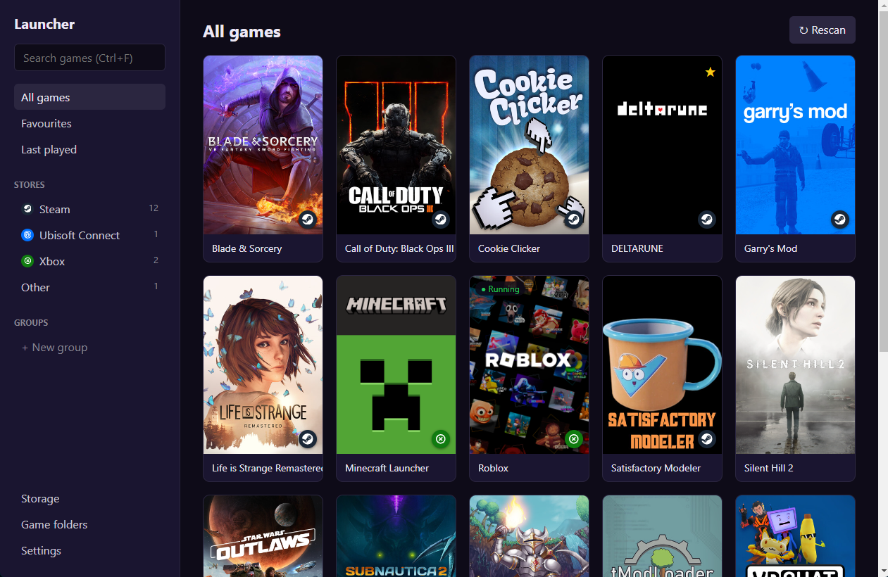
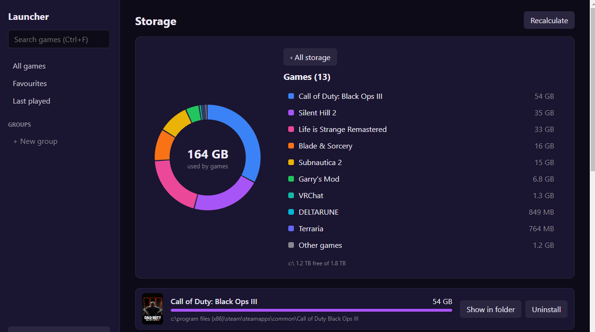
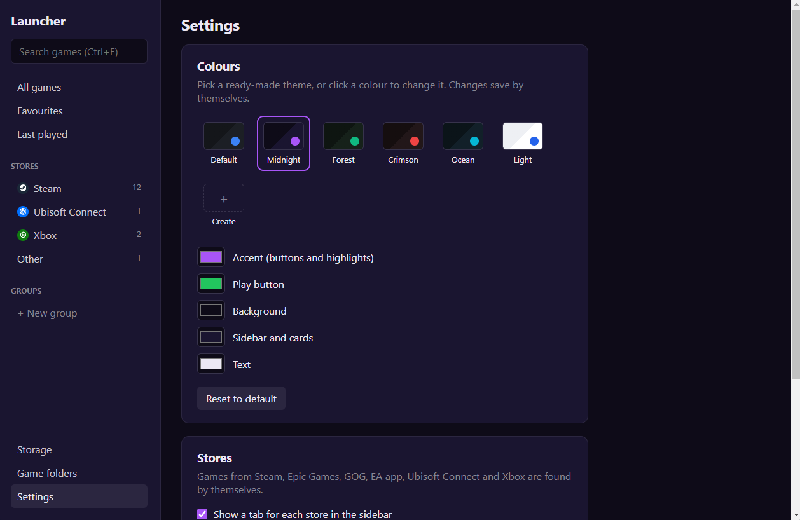

# AIO Game Launcher

One place for every game on your Windows PC. It finds your Steam games by
itself, plus games in any folders you choose, and gives them proper artwork,
playtime stats and a tidy library.

## Download

Get the latest version from the [Releases page](../../releases/latest):

- **Game Launcher Setup.exe**: installs the launcher with desktop and Start
  menu shortcuts. Run a newer one to update; your library is kept.
- **Game Launcher portable.zip**: no install. Unzip anywhere (even a USB stick)
  and run `Game Launcher.exe`. It keeps its library in a `Game Launcher data`
  folder next to itself.

### Requirements

- Windows 10 or 11, 64-bit
- That's it. Everything the launcher needs is built in, so there's nothing
  else to install. Steam is optional: with it, your Steam games are found
  automatically.

Windows may say "Windows protected your PC" because the app isn't signed.
Click **More info**, then **Run anyway**.

## Features

- Finds installed Steam games automatically, plus games in folders you add
- Steam artwork (covers, banners, logos), even for non-Steam games: rename a
  game to its proper name and the art is fetched
- Play button shows Launching..., then Close game while the game runs
- Playtime tracking with week, month and year charts
- Favourites, Last played, and your own groups (drag games onto them)
- Storage page: how much space each game takes, and uninstall from the launcher
  (through Steam, the game's own uninstaller, or the Recycle Bin)
- Colour themes, plus your own saved themes
- Search from anywhere with Ctrl+F

## For developers

Needs [Node.js](https://nodejs.org) (LTS). The code is in [`src`](src) and the
automatic tests in [`tests`](tests); each folder has a short guide to its files.

| What | How |
| --- | --- |
| Run from the code | `npm install` once, then `npm start` |
| Run the tests | `npm test` or double-click `Run tests.bat` |
| Build installer + zip | `npm run dist` or double-click `Build launcher.bat` (output in `dist`) |
| Publish a release | bump `version` in package.json, then Actions → Release → Run workflow; it builds on Windows and attaches the downloads |

The tests start the real launcher with pretend games and a throwaway library,
so your own library is never touched.
